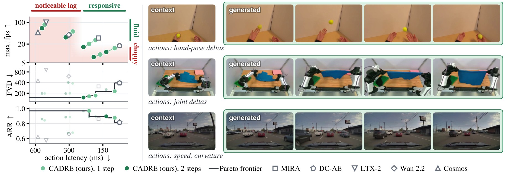
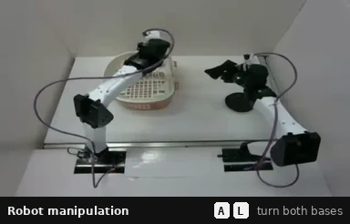
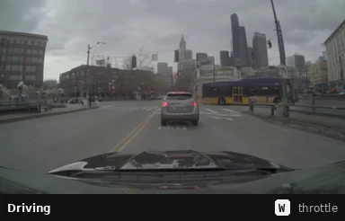
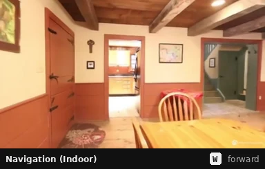
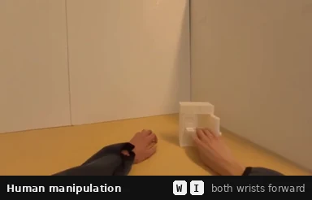

# Rethinking Video Autoencoders for Interactive World Models

**CADRE**: **CA**usal **D**iffusion **RE**presentation autoencoders

Adrien Ramanana Rahary<sup>1,2</sup>, Yutong Bai<sup>3</sup>, Nicolas Dufour<sup>1</sup>, Patrick Pérez<sup>1*</sup>,
David Picard<sup>2</sup>

<sup>1</sup>Kyutai &nbsp; <sup>2</sup>École Nationale des Ponts et Chaussées &nbsp; <sup>3</sup>BAIR, UC Berkeley &nbsp;
<sup>*</sup>work done while at Kyutai

[](#citation)
[](https://wmoptimal.github.io)
[](#models)
[](LICENSE)



**CADRE** is a family of causal video autoencoders built for interactive world models: a trained bottleneck on frozen
DINOv3 features and a causal diffusion decoder that runs in one or two steps. World models trained on CADRE latents run
at 20 fps on one H100 and react in under 230 ms, in robot and human manipulation, driving and indoor navigation.

This repository trains and evaluates the autoencoders, the world models and the action probes, and serves an
interactive demo.

<table>
  <tr>
    <td></td>
    <td></td>
  </tr>
  <tr>
    <td></td>
    <td></td>
  </tr>
</table>

<sub>Generated interactively in real time (20 fps, one H100) by the released world models, from the keys in each
caption.</sub>

## Installation

```sh
git clone https://github.com/AdrienRR/cadre-autoencoders-and-world-models && cd cadre-autoencoders-and-world-models
uv sync                  # add --extra demo for the demo, --extra prepare for the data scripts
```

## Interactive demo

```sh
uv run --extra demo python demo.py --data robot_manipulation=<root> human_manipulation=<root> driving=<root> \
    indoor_navigation=<root>
```

Open http://localhost:8000. The world models download from the Hub; `--data` points to datasets in the
[DATA.md](DATA.md) format, whose clips start each rollout. The page lists the controls.

## Models

All weights are on the Hugging Face Hub, in the
[CADRE Autoencoders & World Models](https://huggingface.co/collections/kyutai/cadre-autoencoders-and-world-models-6abbaa26ed6191f7c975072d)
collection.

- `kyutai/cadre-world-models-2x16x16`: the world models of the four environments, on CADRE-2x16x16.
- `kyutai/cadre-<τ>x<s>x<s>`: the seven autoencoders of the paper (τ frames and s×s pixels per token);
  **CADRE-2x16x16** is the recommended one. `kyutai/cadre-<cell>-multires`: four of them trained further, with better
  reconstructions at several resolutions.
- `kyutai/cadre-action-probes`: the probes that measure how well rollouts follow their actions (ARR).

```python
from model_autoencoder import CADRE
from model_world_model import load_pretrained

autoencoder = CADRE.from_pretrained("kyutai/cadre-2x16x16")
world_model, autoencoder = load_pretrained("kyutai/cadre-world-models-2x16x16", "driving", device="cuda")
```

Every script also accepts a repo id wherever it takes a checkpoint.

## Data

The datasets are public and not redistributed here: [ABC-130k](https://huggingface.co/datasets/XDOF/ABC-130k),
[EgoDex](https://github.com/apple/ml-egodex), [PhysicalAI-AV](https://huggingface.co/datasets/nvidia/PhysicalAI-Autonomous-Vehicles)
and [RealEstate10K](https://huggingface.co/datasets/chenchenshi/re10k-sc). Convert each one exactly as we did with

```sh
uv run --extra prepare python prepare/<environment>.py --src <download> --out <root>
uv run --extra prepare python prepare/check.py --env <environment> --root <root>   # compares with ours
```

EgoDex also needs the [MANO](https://mano.is.tue.mpg.de) hand model (`--mano_dir`). [DATA.md](DATA.md) covers the
downloads and the format, which you can also use for your own videos.

## Training

```sh
# Autoencoder (the paper's): 150k steps.
uv run torchrun --nnodes 2 --nproc_per_node 8 main_autoencoder.py --model cadre_2x16x16 \
    --config configs/autoencoder/pretrain.yaml --data <root> ... --dino_weights <dinov3_vitb16 .pth> --output_dir <dir>

# Further training (the -multires autoencoders): a cooldown to 360k steps, then a multi-resolution fine-tune to 400k.
uv run torchrun ... main_autoencoder.py --model cadre_2x16x16 --config configs/autoencoder/cooldown_360k.yaml \
    --continue_from <dir>/checkpoint-149999 --data <root> ... --output_dir <dir2>
uv run torchrun ... main_autoencoder.py --model cadre_2x16x16 --config configs/autoencoder/multires_ft.yaml \
    --continue_from <dir2>/checkpoint-359999 --data <root> ... --output_dir <dir3>

# World model: 100k steps.
uv run torchrun --nnodes 2 --nproc_per_node 8 main_world_model.py --env driving \
    --autoencoder kyutai/cadre-2x16x16 --data <root> --output_dir <dir>

# Action probe: 60k steps.
uv run torchrun --nproc_per_node 8 main_idm.py --env driving --data <root> --dino_weights <dinov3_vitb16 .pth> \
    --output_dir <dir>
```

The recipes in `configs/` set the rest (global batch sizes are kept on any number of GPUs). Training logs the
paper's metrics on the dataset's `val` split to `log.jsonl`.

## Evaluation

```sh
# World model rollouts: FID, FVD, PSNR, LPIPS and, with a probe, ARR.
uv run torchrun --nproc_per_node 8 main_eval.py rollout --env driving \
    --checkpoint kyutai/cadre-world-models-2x16x16/driving --probe kyutai/cadre-action-probes/driving \
    --data <root> --manifest manifests/driving_test.txt

# Autoencoder reconstructions on OpenVid-HD (https://huggingface.co/datasets/nkp37/OpenVid-1M).
uv run torchrun --nproc_per_node 8 main_eval.py reconstruction --checkpoint kyutai/cadre-2x16x16 \
    --data <root> --manifest manifests/openvid_hd_test.txt
```

`manifests/` lists the paper's evaluation clips.

## Citation

```bibtex
@misc{ramananarahary2026cadre,
  title  = {Rethinking Video Autoencoders for Interactive World Models},
  author = {Ramanana Rahary, Adrien and Bai, Yutong and Dufour, Nicolas and P{\'e}rez, Patrick and Picard, David},
  year   = {2026},
  note   = {arXiv link coming soon}
}
```

## License

Code: [MIT](LICENSE). Weights: [CC-BY-NC 4.0](https://creativecommons.org/licenses/by-nc/4.0/); their frozen DINOv3
encoder is under Meta's [DINOv3 License](https://github.com/facebookresearch/dinov3/blob/main/LICENSE.md).

## Acknowledgements

CADRE builds on [DINOv3](https://github.com/facebookresearch/dinov3), [RAE](https://github.com/bytetriper/RAE),
[MIRA](https://github.com/mira-wm/mira), [LPIPS](https://github.com/richzhang/PerceptualSimilarity),
[pytorch-fid](https://github.com/mseitzer/pytorch-fid), [cd-fvd](https://github.com/songweig/content-debiased-fvd), and
on the [ABC-130k](https://huggingface.co/datasets/XDOF/ABC-130k), [EgoDex](https://github.com/apple/ml-egodex),
[PhysicalAI-AV](https://huggingface.co/datasets/nvidia/PhysicalAI-Autonomous-Vehicles),
[RealEstate10K](https://huggingface.co/datasets/chenchenshi/re10k-sc) and
[OpenVid-1M](https://huggingface.co/datasets/nkp37/OpenVid-1M) datasets.
